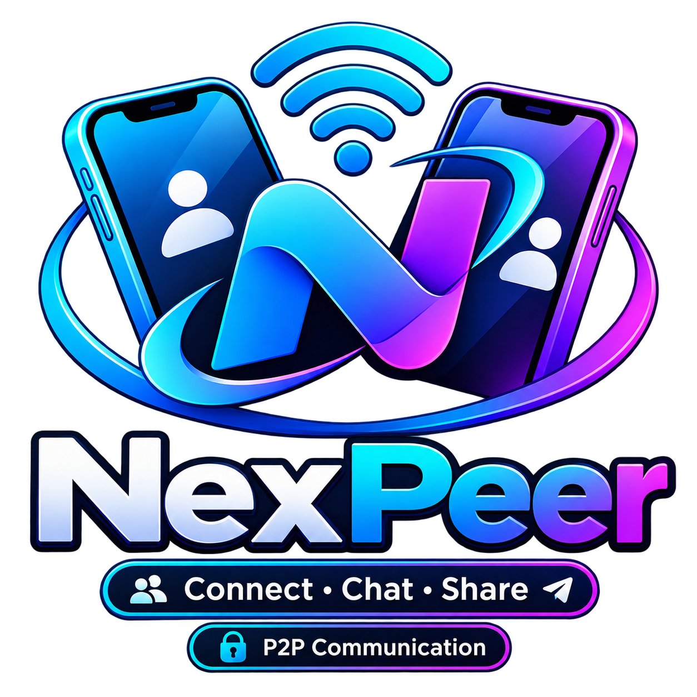

# NexPeer

<p align="center">
  
</p>

<p align="center"><strong>Private. Direct. Peer-to-peer.</strong></p>

**Private. Direct. Peer-to-peer.**

NexPeer is a cross-platform messaging application built with **Flutter and Dart**. The project currently provides the application UI, Supabase-backed authentication and contact synchronization, and an initial service architecture for future peer-to-peer communication.

> **Project status:** Active development. The current release is not yet a working peer-to-peer messenger: native peer discovery, device pairing, and message transport have not been implemented.

## Contents

- [Overview](#overview)
- [Current capabilities](#current-capabilities)
- [Implementation status](#implementation-status)
- [Technology stack](#technology-stack)
- [Requirements](#requirements)
- [Setup](#setup)
- [Supabase configuration](#firebase-configuration)
- [Run and test](#run-and-test)
- [Build](#build)
- [Project structure](#project-structure)
- [Security notes](#security-notes)
- [Continuous integration](#continuous-integration)
- [Roadmap](#roadmap)
- [Contributing](#contributing)
- [License](#license)

## Overview

NexPeer is being developed around these principles:

- **Privacy first:** make privacy and clear security boundaries part of the design.
- **Direct communication:** work toward device-to-device messaging when a supported transport is available.
- **Transparent behavior:** never display a simulated connection or claim a message was delivered when it was not.
- **Modular development:** keep UI, authentication, cryptographic utilities, and transport responsibilities separated.
- **Cross-platform foundation:** use Flutter to target supported mobile and desktop platforms as implementation progresses.

## Current capabilities

The repository currently includes:

- Flutter application shell with Material 3 dark theme.
- Splash screen and authentication gate.
- Supabase Auth integration for email/password, Google, and Apple sign-in.
- Login, registration, and password-reset UI flows.
- Home, nearby-device, chat, story, call, and profile interface areas.
- Initial P2P service abstraction and connection/message streams.
- Basic hashing and Base64 utility methods.
- Widget tests for startup and the missing-Firebase-configuration state.
- GitHub Actions workflow for Dart analysis and Flutter tests.

The presence of an interface or service abstraction does not mean the corresponding production backend or transport is complete. See the status table below.

## Implementation status

| Area | Current status |
| --- | --- |
| Flutter app shell and navigation | Implemented |
| Splash and authentication routing | Implemented |
| Supabase Auth integration | Implemented; requires project configuration and provider setup |
| Chat interface | UI available; real message delivery unavailable |
| Nearby device interface | UI available; native discovery unavailable |
| P2P pairing and transport | Not implemented |
| Message persistence and synchronization | Not implemented |
| End-to-end encryption | Not implemented |
| File transfer | Planned |
| Voice and video calls | UI concepts only; calling transport not implemented |
| Stories backend and synchronization | UI concepts only; backend not implemented |

**Important:** The current P2P service deliberately rejects message sending because no native transport adapter is connected. The device screen also reports that discovery is unavailable. Do not treat the current app as suitable for private or production messaging.

## Technology stack

| Technology | Purpose |
| --- | --- |
| Flutter | Cross-platform UI framework |
| Dart | Application language |
| Material 3 | UI components and theming |
| Supabase Flutter | Firebase initialization |
| Supabase Auth | User authentication |
| Supabase OAuth (Google) | Google identity integration |
| Supabase OAuth (Apple) | Apple identity integration |
| `crypto` | Hashing utilities |
| GitHub Actions | Automated analysis and tests |

Dependency versions are maintained in [`pubspec.yaml`](pubspec.yaml). Run `flutter pub get` to install the versions resolved for your checkout.

## Requirements

Install the following tools before starting development:

- Flutter SDK (stable channel).
- Dart SDK compatible with the constraint in `pubspec.yaml` (provided by Flutter).
- Android Studio and Android SDK for Android development.
- Xcode for iOS development (macOS only).
- Git.

Check your environment:

```bash
flutter doctor
flutter --version
dart --version
```

## Setup

Clone the repository:

```bash
git clone https://github.com/Strong-Bee/NexPeer.git
cd NexPeer
```

Install dependencies:

```bash
flutter pub get
```

## Supabase configuration

Supabase is required for the authentication flow. The repository does not include project-specific Supabase configuration files; configure your own Firebase project before expecting authentication to work.

1. Create a project in the [Firebase Console](https://console.firebase.google.com/).
2. Register each platform application using the matching Android application ID or iOS bundle ID.
3. Add the generated native configuration:
   - **Android:** place `google-services.json` in `android/app/`.
   - **iOS:** add `GoogleService-Info.plist` to `ios/Runner/` and ensure it is included in the Runner target in Xcode.
4. Enable the authentication providers you intend to use under **Authentication → Sign-in method**:
   - Email/Password
   - Google
   - Apple (requires the relevant Apple Developer and Firebase provider configuration)
5. Complete any provider-specific platform setup, including OAuth client configuration, Android signing fingerprints, URL schemes, and Apple capabilities where applicable.
6. Rebuild and run the app.

The application attempts to initialize Firebase at startup. If Firebase is unavailable or the platform configuration is missing, it remains launchable and displays a setup message rather than bypassing the authentication gate.

**Never commit** service-account JSON files, private keys, signing credentials, or other secrets. Keep environment-specific credentials out of source control.

## Supabase configuration

NexPeer uses Supabase Auth and PostgreSQL as its central backend. SQLite stores a local cache of contacts. Firebase is no longer used.

1. Create a Supabase project and copy its Project URL and publishable key.
2. Apply `supabase/migrations/20261105000000_nexpeer_profiles_contacts.sql` in the Supabase SQL Editor.
3. Enable Email authentication and configure Google / Apple providers under Authentication → Providers if needed.
4. Add `nexpeer://login-callback` and `nexpeer://reset-password` to the Supabase Auth redirect URL allow list.
5. Configure provider credentials and callback URLs in Google Cloud / Apple Developer.
6. Run with:

```bash
flutter run --dart-define=SUPABASE_URL=https://YOUR_PROJECT_REF.supabase.co --dart-define=SUPABASE_PUBLISHABLE_KEY=YOUR_PUBLISHABLE_KEY
```

Never embed a `service_role` or secret key in the Flutter app. The SQL migration enables RLS and grants authenticated API access explicitly. Profile lookup is available to signed-in users; contact rows are owner-restricted. SQLite is only a local cache.

**Firebase account migration:** existing Firebase users are not automatically transferred. Supabase issues new user IDs, so passwords, profile IDs, QR codes, and contacts require a separately planned migration and account verification.

## Run and test

List available devices:

```bash
flutter devices
```

Run on the selected device:

```bash
flutter run
```

Run on Android:

```bash
flutter run -d android
```

Run static analysis:

```bash
flutter analyze
```

Run automated tests:

```bash
flutter test
```

If you encounter stale build artifacts:

```bash
flutter clean
flutter pub get
```

## Build

Build a release APK:

```bash
flutter build apk --release
```

The APK is normally written to:

```text
build/app/outputs/flutter-apk/app-release.apk
```

Build separate APKs for supported Android CPU architectures:

```bash
flutter build apk --split-per-abi
```

A successful build does not by itself verify Firebase provider configuration, real device discovery, or P2P message delivery. Those require platform-specific and device-level testing.

## Project structure

The main application code is organized under `lib/`:

```text
NexPeer/
├── .github/
│   └── workflows/
│       └── flutter-ci.yml
├── android/
├── ios/
├── lib/
│   ├── main.dart
│   ├── models/
│   ├── screens/
│   │   ├── auth/
│   │   ├── call/
│   │   ├── chat/
│   │   ├── devices/
│   │   ├── home/
│   │   ├── profile/
│   │   ├── splash/
│   │   └── story/
│   ├── services/
│   │   ├── auth_service.dart
│   │   ├── crypto_service.dart
│   │   └── p2p_service.dart
│   └── widgets/
│       ├── auth/
│       ├── chat/
│       └── devices/
├── test/
├── analysis_options.yaml
├── pubspec.yaml
└── README.md
```

Some platform folders and feature modules may contain additional files not shown in this high-level overview.

## Security notes

Security claims must reflect implemented and independently verified behavior.

- SHA-256, SHA-1, and MD5 methods in the current crypto utility are **hash functions**, not encryption.
- Base64 is an encoding format, not encryption.
- Do not use MD5 or SHA-1 for new security-sensitive designs.
- Do not implement custom encryption or invent a key-exchange protocol.
- A production messaging implementation needs authenticated key establishment, authenticated encryption, secure key storage, replay protection, identity verification, and a reviewed protocol.
- The current P2P service is not a secure transport and does not deliver messages.
- Review Supabase Auth rules and any future database/storage security rules before production deployment.

A future end-to-end encryption design should use established, reviewed cryptographic protocols and receive independent security review before being described as production-ready.

## Continuous integration

The workflow at [`.github/workflows/flutter-ci.yml`](.github/workflows/flutter-ci.yml) runs on pushes to `main`, `fix/**`, and `feature/**`, and on pull requests targeting `main`.

The current CI job:

1. Checks out the repository.
2. Installs the Flutter stable channel.
3. Runs `flutter pub get`.
4. Runs `flutter analyze --no-pub`.
5. Runs `flutter test --no-pub`.

CI currently validates analysis and automated tests; it does not perform a release build or physical-device P2P testing.

## Roadmap

- [x] Flutter app foundation and primary interface areas
- [x] Authentication gate and Firebase Auth service integration
- [x] Startup fallback when Supabase configuration is missing
- [x] Automated Flutter analysis and widget-test workflow
- [x] Honest UI/service behavior when P2P transport is unavailable
- [ ] Complete Firebase setup documentation and platform verification
- [ ] Implement native peer discovery for supported platforms
- [ ] Implement secure peer pairing and connection lifecycle
- [ ] Integrate a real P2P data transport
- [ ] Add message persistence, delivery state, and synchronization
- [ ] Design and review end-to-end encryption
- [ ] Add file transfer with integrity checks and resumability
- [ ] Implement voice/video calling and signaling
- [ ] Implement story storage, privacy controls, and expiration
- [ ] Add broader integration and device-level tests

## Contributing

Contributions are welcome, especially bug fixes, tests, accessibility improvements, documentation, and carefully scoped transport work.

1. Fork the repository.
2. Create a feature branch.
3. Make focused changes and add or update tests.
4. Run `flutter analyze` and `flutter test`.
5. Open a pull request describing the change, verification performed, and any platform-specific limitations.

Example:

```bash
git checkout -b feature/describe-your-change
flutter pub get
flutter analyze
flutter test
git add .
git commit -m "feat: describe your change"
git push origin feature/describe-your-change
```

Do not include Firebase credentials, signing keys, user data, or generated secrets in pull requests.

## Bug reports

When reporting a bug, include:

- Device and operating system version.
- Flutter and Dart versions.
- Steps to reproduce.
- Expected and actual behavior.
- Relevant sanitized logs or screenshots.
- Whether Firebase was configured for the affected platform.

Remove access tokens, email addresses, device identifiers, and other private information from logs before sharing them.

## License

No license file is currently included in this repository. Unless and until a license is added, do not assume that the source code is available for unrestricted reuse, redistribution, or modification.

---

**NexPeer** — built with Flutter and Dart.

**Cyber Technology Project**


## Chat attachments

The chat composer supports selecting multiple image files from the photo picker and general files through the system file picker. It accepts common formats such as PDF, PNG, JPG/JPEG, GIF, WebP, DOC/DOCX, XLS/XLSX, PPT/PPTX, TXT, CSV, and archives, as well as other file types exposed by the operating system.

- Maximum size: 25 MB per file and 50 MB total in the current attachment selection.
- Selected files appear in a removable preview list before sending.
- File-type icons and file sizes are shown in the attachment preview.
- Attachments remain local and in-memory while they are pending; they are not uploaded or persisted.
- **Actual transfer is not available yet.** The native P2P transport and file-transfer adapter are not implemented. Attempting to send a selected file reports this limitation and does not mark the file as sent. Do not use this build to transfer files between devices.
